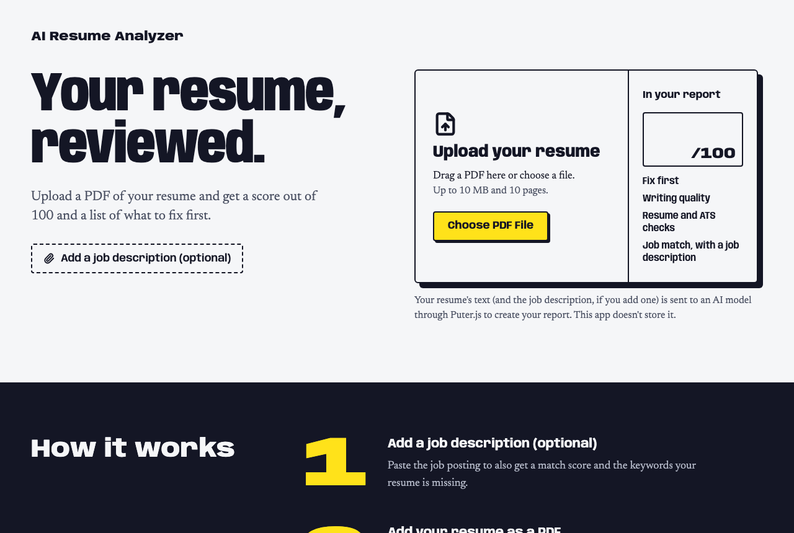
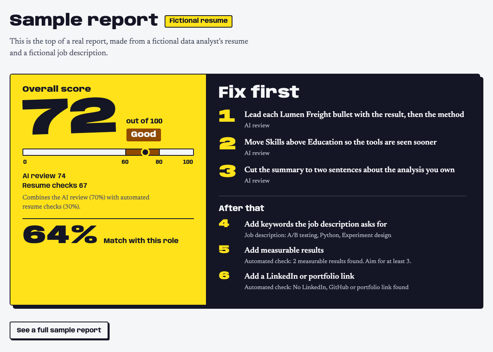
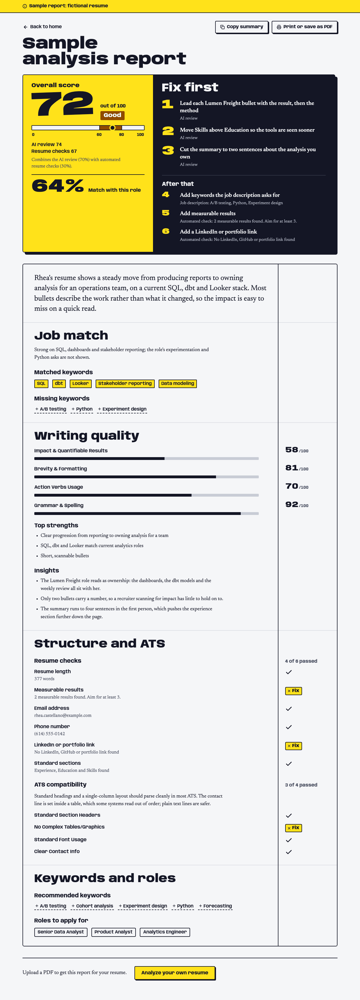
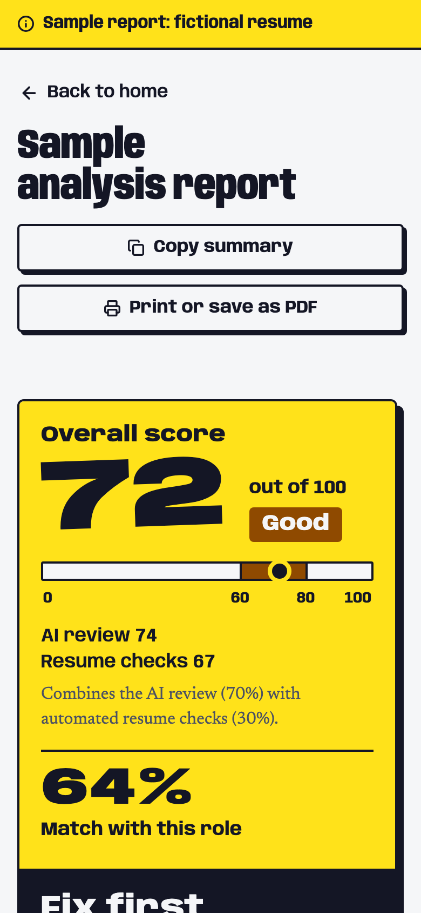

# AI Resume Analyzer

🔗 [Live Demo](https://ai-resume-analyzer-rajcodes.vercel.app/)

Upload a PDF resume and get it back reviewed: a score out of 100, a ranked list of what to fix first, writing scores, automated resume and ATS checks, and an optional match against a job description. It is a client-side React app with no backend; the PDF is read in your browser and the AI review goes through [Puter.js](https://puter.com).



The homepage also shows a live sample report, built from a fictional resume:



| Full report (sample) | On a phone |
|---|---|
|  |  |

## ✨ Features

**The report**
- **Verdict first**: a large stamped score with its rating (Excellent, Good or Needs Improvement), a scale showing where 60 and 80 fall, the AI and check scores behind it, and the job match percentage.
- **Fix first**: a ranked to-do list built from failed checks, the AI's main improvements and missing job keywords. When there is nothing urgent, the panel says so instead of disappearing.
- **Reviewed sheet**: the AI's summary, then Job match, Writing quality, Structure and ATS, and Keywords and roles, with a marks column like an examiner's margin (✓ for passed rows, a yellow **Fix** flag for failed ones).
- **Blended, more stable score**: 70% AI review plus 30% from six checks computed in code: length, measurable results, email, phone, LinkedIn/portfolio link and standard sections.
- **Job description match (optional)**: paste a job posting to get a match score, a short fit summary, and the keywords the resume already has or is missing.
- **Share it**: copy a plain-text summary, or print it / save it as a PDF with a clean, light print layout.

**The homepage**
- **Upload sheet**: drag a PDF onto it or choose a file (keyboard accessible), with an optional job description.
- **How it works**: three steps, including what kind of PDF works.
- **Live sample report**: the top of a real report for a fictional resume, clearly labelled, plus a full sample report you can open without uploading anything. The sample never calls the AI.
- **What happens to your resume**: a plain explanation of what is read locally, what is sent to the AI, and what is (not) kept.

**Under the hood**
- **In-browser PDF parsing** with Mozilla's `pdfjs-dist` in a Web Worker, loaded on demand so the first page load stays small.
- **Structured AI analysis**: strict JSON from a pinned model (`claude-sonnet-5-5` via Puter.js); every reply is validated and normalized, and an unreadable reply is retried once.
- **Accessible**: step-by-step progress announced to screen readers, focus moved to the report when it opens, a visible keyboard focus ring everywhere, reduced motion respected, and a Windows High Contrast-friendly drag state.
- **Clear error handling**: separate messages for wrong file type, oversized files, too many pages, password-protected PDFs, image-only PDFs, slow or failed PDF loading, a too-short job description, AI timeouts, Puter sign-in or usage-limit problems and unreadable AI replies, plus error boundaries so a rendering failure never blanks the page.

## 🎨 Design

A "reviewed document" look: cool paper `#F5F6F8`, blue-black ink `#141625` and one fluorescent highlighter accent `#FFE21A`, with hard ink borders and offset shadows. Type is [Anybody](https://fonts.google.com/specimen/Anybody) for headings, marks and the big numbers, and [Newsreader](https://fonts.google.com/specimen/Newsreader) for the AI's text. Both fonts are self-hosted from `public/fonts/` under the SIL Open Font License, so the page makes no request to Google. One signature motion: when a report opens, a highlighter swipes the score block and the number stamps in (off for reduced motion).

## 🔒 Privacy

- The PDF file itself never leaves your browser; only its **extracted text** is sent for analysis.
- That text, including any name, email or phone number in your resume, **is sent to an AI model via Puter.js**, a third-party service, together with the job description if you add one. Remove details you don't want to share before uploading.
- This app keeps no database, no analytics and no saved reports. (Puter.js may keep its own sign-in data in your browser.)
- The first analysis may open a Puter sign-in window. See [Puter's documentation](https://docs.puter.com) for how its AI usage works.

## 🛡️ Security

- `vercel.json` sends security headers on every response: `X-Content-Type-Options`, `Referrer-Policy`, `Permissions-Policy`, `X-Frame-Options: DENY` and a Content-Security-Policy that blocks framing, `<object>`, base-URL changes and cross-site form posts. Script and connection rules are left open on purpose so Puter.js and its sign-in window keep working.
- `pdfjs-dist` is kept at 6.2.108 or newer ([GHSA-hq66-cqwq-w95j](https://github.com/advisories/GHSA-hq66-cqwq-w95j)).
- Text inside the resume or job description can't break out of its prompt section (delimiter tags are stripped).

## 📏 Limits

| Limit | Value |
|---|---|
| File type | PDF with selectable text (scanned images are not supported) |
| File size | 10 MB |
| Pages | 10 |
| PDF reading time | 30 seconds |
| Text analyzed | First 15,000 characters (the report notes when text was cut) |
| Job description | Optional; 100 to 5,000 characters |
| AI timeout | 2 minutes |

## 🛠 Tech Stack

- **Framework**: React 19 + Vite
- **Styling**: Plain CSS with custom properties and container queries
- **Fonts**: Anybody + Newsreader (self-hosted, OFL)
- **PDF parsing**: `pdfjs-dist`
- **AI**: Puter.js
- **Icons**: `lucide-react`
- **Testing**: Vitest (unit) and Playwright (end-to-end)

## 🚀 Getting Started

Requires Node.js 22.13 or newer.

```bash
git clone https://github.com/Ra-jj/AI-Resume-Analyzer.git
cd AI-Resume-Analyzer
npm install
npm run dev
```

Then open http://localhost:5173.

| Command | What it does |
|---|---|
| `npm run dev` | Start the dev server |
| `npm run build` | Production build into `dist/` |
| `npm run preview` | Serve the production build locally |
| `npm run lint` | Run ESLint |
| `npm test` | Run the unit tests (Vitest) |
| `npm run test:watch` | Run the unit tests in watch mode |
| `npm run test:e2e` | Run the end-to-end tests (Playwright; run `npx playwright install chromium` once first) |

## 🧪 Testing

- **Unit tests**: 699 Vitest tests next to the modules they cover (`src/**/*.test.js`): response normalization, AI error mapping, resume checks, score blending and ratings, the Fix first ranking, the fictional sample report, prompt building and the Puter call (with a stubbed `puter`).
- **End-to-end tests**: 174 Playwright tests drive a fresh production build in Chromium with real PDFs and a stubbed AI: the homepage and its sample report, uploads and drag-and-drop, the job description flow, the report layout and score ratings, almost every error message, keyboard order and focus, screen-reader announcements, reduced motion, copy and print, fonts, security headers and layouts from 320px phones to wide desktops. No test ever contacts Puter or any other outside site.
- **CI**: every push to `main` and every pull request runs install, lint, unit tests, build and end-to-end tests in GitHub Actions.

## 🗺️ Known follow-ups

- Move focus to the error message after a failed analysis.
- Join pdf.js text fragments more carefully so long links aren't split in the Resume Checks details.

## 💡 How It Works

1. **Upload**: the file is checked for type and size before anything else runs.
2. **Parse**: pdf.js extracts the text from each page in a Web Worker.
3. **Analyze**: the text (and the job description, if given) is sent to the pinned AI model with a prompt that requires a fixed JSON structure, while automated checks run on the full text in the browser.
4. **Validate**: the response is parsed and normalized into a guaranteed shape.
5. **Report**: the AI score and check score are blended, the Fix first list is ranked, and the report renders.

## 📁 Project Structure

```
src/
├── App.jsx                     # Switches between home, report and sample report
├── main.jsx                    # Entry point, top-level error boundary, stray-drop guard
├── index.css                   # All styles and design tokens
├── hooks/
│   └── useResumeAnalysis.js    # Upload-flow state: validate → extract → analyze
├── services/
│   ├── pdf.js                  # Lazy-loaded pdf.js text extraction
│   └── analyze.js              # Puter.js AI call and response handling
├── components/
│   ├── UploadView.jsx          # Homepage with the upload sheet
│   ├── JobDescriptionInput.jsx # Optional job description field
│   ├── AnalysisProgress.jsx    # Step-by-step loading indicator
│   ├── DashboardView.jsx       # Report screen (real or sample)
│   ├── ErrorBoundary.jsx       # Fallback UI for rendering failures
│   ├── home/                   # Homepage sections (report preview column, how it works, sample, privacy, footer)
│   └── report/                 # Report parts (header, verdict, score, Fix first, sheet)
└── lib/                        # Pure helpers (no React, no network)
    ├── analysis.js             # JSON extraction and response normalization
    ├── resumeChecks.js         # Automated resume checks computed in code
    ├── report.js               # Blends AI and check scores; rating thresholds
    ├── fixFirst.js             # Ranked "Fix first" to-do list
    ├── sampleReport.js         # Fictional sample report, built through the real pipeline
    ├── reportText.js           # Plain-text report summary for copying
    ├── aiErrors.js             # Maps Puter failures to error codes
    ├── prompt.js               # Builds the AI messages and strips injected delimiter tags
    ├── errors.js               # Error codes and user-facing messages
    ├── files.js                # File type/size checks
    └── limits.js               # Limits, timeouts and text helpers
public/
└── fonts/                      # Self-hosted Anybody + Newsreader (woff2 + OFL licences)
```
